# KSTPL DevOps / IaC Demo (AWS + Terraform)

Production-style demo: VPC, ECS on EC2 (nginx-a / nginx-b behind one ALB), and a serverless upload API
(API Gateway HTTP API -> Lambda -> S3), with least-privilege IAM and CloudWatch logging.

## Architecture

```
                         Internet
                            |
              +-------------+--------------+
              |                            |
        [ ALB :80 ]                 [ API Gateway HTTP API ]
        (public subnets x2)           POST /upload?filename=x
         weighted 50/50                     |
         +-------+-------+              [ Lambda (python3.12) ]
         |               |                  | s3:PutObject only
   TG nginx-a        TG nginx-b             v
         |               |            [ S3 uploads bucket ]
   +-----+---------------+----+        (private, SSE, lifecycle)
   |  ECS cluster (EC2, ASG)  |
   |  private-app subnets x2  |  --NAT--> Internet (image pull)
   |  nginx-a x2, nginx-b x2  |
   +--------------------------+
   private-data subnets x2 (isolated, no internet route; reserved for DB tier)

Logs: ECS awslogs -> /ecs/kstpl-demo-nginx-{a,b}   Lambda -> /aws/lambda/kstpl-demo-upload
```

## Layout

```
modules/vpc         VPC, 3 subnet tiers x 2 AZs, IGW, NAT, route tables
modules/iam         EC2 instance role, ECS task execution role, Lambda role (inline scoped policies)
modules/ecs         Cluster, Launch Template + ASG, ALB, target groups, task defs, services, autoscaling
modules/lambda_api  S3 bucket, Lambda, HTTP API, permissions
environments/demo   Root config wiring modules together
app/lambda          Lambda source (handler.py)
.github/workflows   CI: fmt, validate, optional plan
```

## Prerequisites
- AWS account + IAM user/role with permission to create the resources above
- Terraform >= 1.5 (or OpenTofu), AWS CLI v2, `curl`
- `aws configure` (or SSO) done; verify with `aws sts get-caller-identity`

## Deploy
```bash
cd environments/demo
terraform init
terraform fmt -recursive ../..
terraform validate
terraform plan -out tfplan
terraform apply tfplan          # ~5-8 min (NAT + ALB + ASG)
terraform output
```
Region defaults to `ap-south-1`; override with `-var region=us-east-1`.

## Test nginx / ALB round-robin
```bash
ALB=$(terraform output -raw alb_url)
for i in $(seq 1 10); do curl -s $ALB | grep -o 'nginx-[ab]'; done   # mix of nginx-a / nginx-b
curl -s $ALB/nginx-a/    # always nginx-a
curl -s $ALB/nginx-b/    # always nginx-b
```
Allow 2-3 minutes after apply for ECS tasks to register as healthy.

## Test upload API
```bash
API=$(terraform output -raw api_upload_url)
BUCKET=$(terraform output -raw bucket_name)
echo "hello kstpl" > test.txt
curl -s -X POST --data-binary @test.txt -H "Content-Type: text/plain" "$API?filename=test.txt"
aws s3 ls s3://$BUCKET/uploads/
# negative tests
curl -s -X POST --data-binary @test.txt "$API?filename=evil.exe"   # 400 extension not allowed
curl -s -X POST --data-binary @test.txt "$API"                      # 400 missing filename
```

## Logs
```bash
aws logs tail /aws/lambda/kstpl-demo-upload --since 10m
aws logs tail /ecs/kstpl-demo-nginx-a --since 10m
```

## IAM summary (see modules/iam/main.tf)
| Role | Permissions |
|------|-------------|
| EC2 instance | AmazonEC2ContainerServiceforEC2Role + AmazonSSMManagedInstanceCore (managed; required by ECS agent/SSM) |
| ECS task execution | Inline: logs:CreateLogStream/PutLogEvents on `/ecs/kstpl-demo-*` only |
| Lambda | Inline: s3:PutObject on `bucket/uploads/*` only; logs on its own log group only |

## Destroy
```bash
terraform destroy
```
S3 bucket uses `force_destroy` (demo only). Confirm nothing remains (NAT Gateway bills hourly).

## CI
`.github/workflows/terraform.yml` runs `fmt -check`, `init -backend=false`, `validate`, and a `plan`
job when repo variable `AWS_ROLE_ARN` (GitHub OIDC role) is set.

## Demo proof

All screenshots are in [`docs/screenshots/`](docs/screenshots). Region: `ap-south-1`.

### 1. Deployment
`terraform apply` completed with **59 resources added**, and the ALB URL, API URL and bucket name were output.

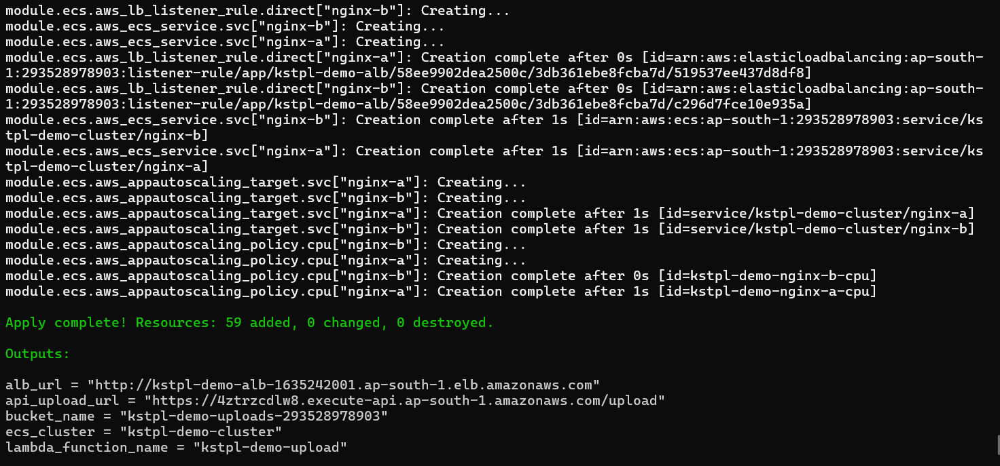

### 2. ALB load balancing (nginx-a vs nginx-b)
Ten requests to the ALB. Responses come from both services (weighted 50/50 forward).

```
Request 1 -> nginx-b   Request 6 -> nginx-b
Request 2 -> nginx-b   Request 7 -> nginx-b
Request 3 -> nginx-a   Request 8 -> nginx-b
Request 4 -> nginx-b   Request 9 -> nginx-b
Request 5 -> nginx-a   Request 10 -> nginx-b
```

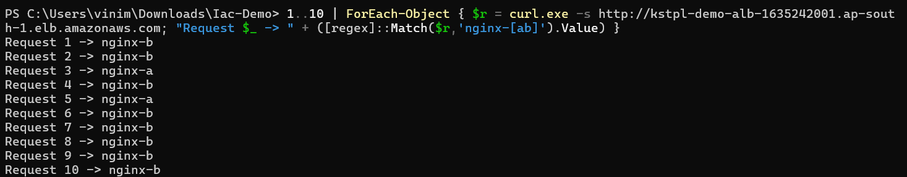

Browser view of the same ALB URL; each service serves its own page (green = nginx-a, blue = nginx-b):

| nginx-a | nginx-b |
|---|---|
| 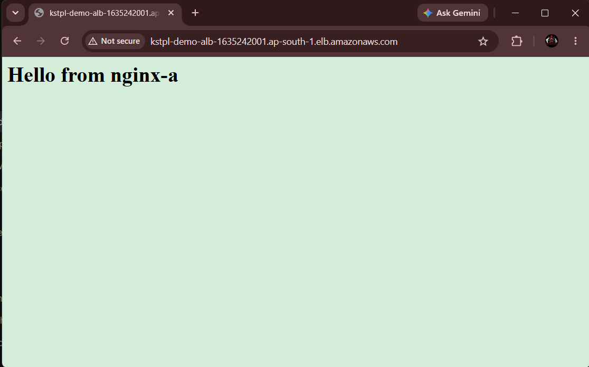 | 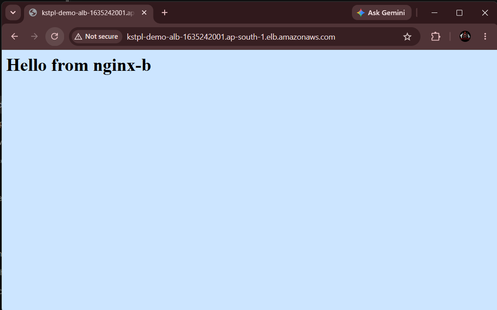 |

### 3. Target groups and ECS
Each target group has 2/2 healthy targets. The ECS cluster runs 2 services with 4 tasks.

| Target group nginx-a | Target group nginx-b |
|---|---|
| 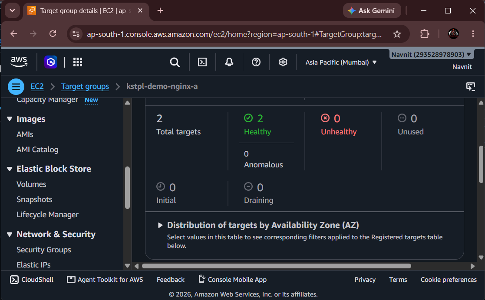 | 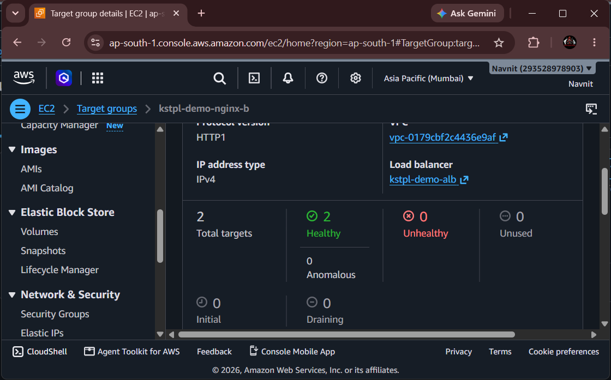 |

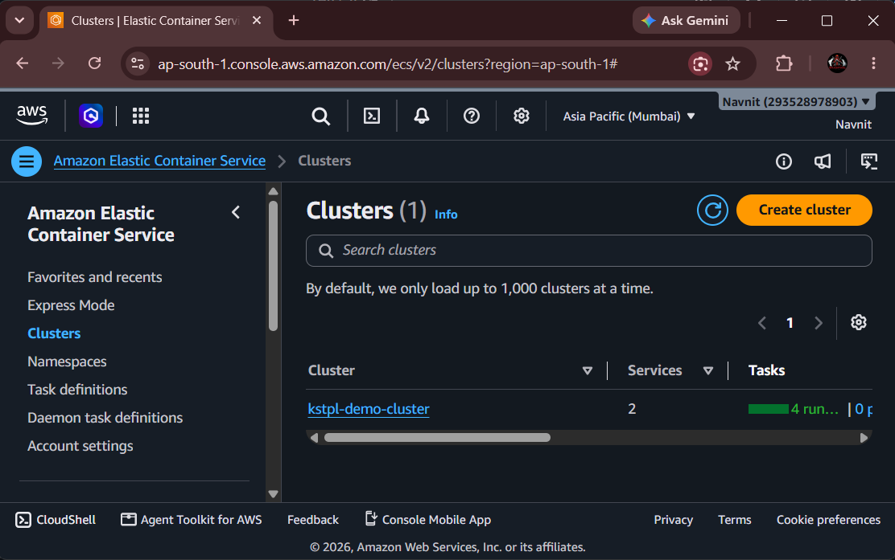
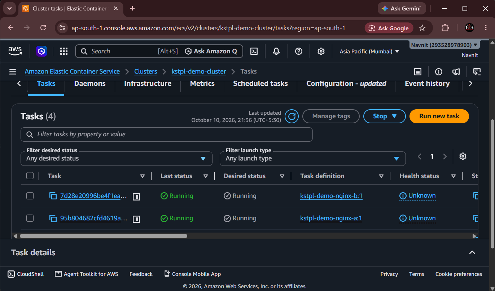

### 4. File upload API -> Lambda -> S3
`POST /upload?filename=test.txt` returns `"message": "uploaded"`:

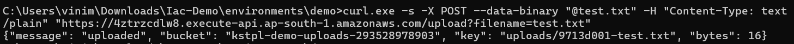

The object appears in the S3 bucket under `uploads/`:

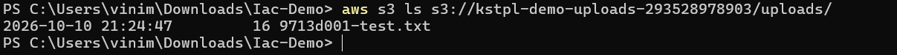

### 5. CloudWatch logs
Lambda log shows `Stored s3://kstpl-demo-uploads-293528978903/uploads/9713d001-test.txt (16 bytes)`.
The ECS nginx container logs are shipped to `/ecs/kstpl-demo-nginx-a` via the `awslogs` driver.

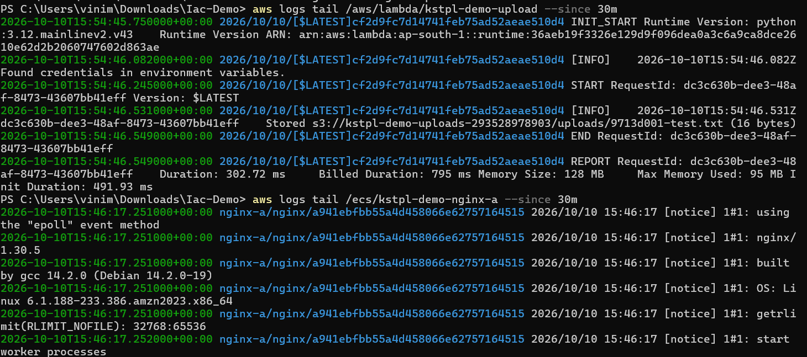

### 6. Input validation and security
Uploading `bad.exe` is rejected with HTTP 400, and nothing is written to S3:

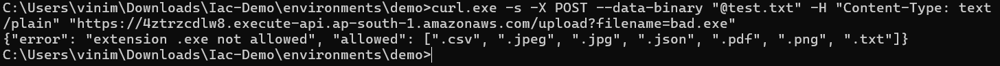
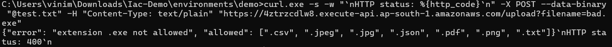

The S3 bucket has **Block all public access** turned on:

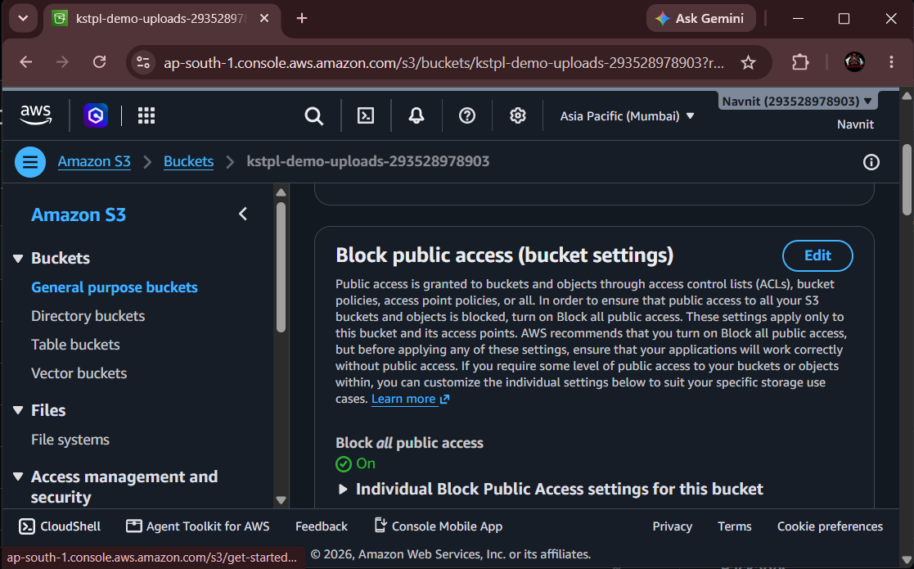
